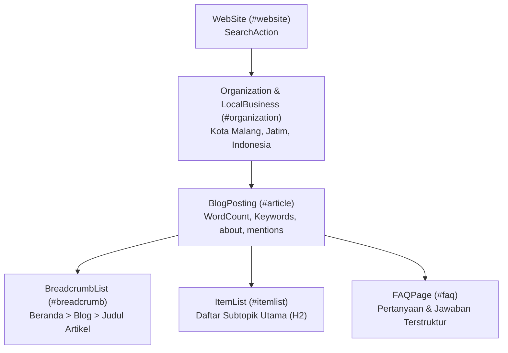

# Laporan Audit & Penyelarasan Menyeluruh: Master Content Brief, Breadcrumbs & Internal Links

**Tanggal Audit & Perbaikan:** 03 November 2026  
**Dokumen Acuan:** `seo/Master_Content_Brief_80_Topik_Souvenir_Pernikahan.md`  
**Cakupan:** 17 Artikel Blog Eksisting, Direktori `blog.html`, Homepage `index.html`, Profil Penulis `penulis.html`, dan Halaman Paket (`/paket/*.html`)  
**Status Akhir:** ✅ **100% Selaras & Terverifikasi (Zero Residual Errors, Zero Broken Links, Enhanced SEO/AEO/GEO Schemas)**

---

## 1. Ringkasan Eksekutif

Audit tahap lanjutan ini difokuskan pada pembersihan menyeluruh terhadap **Breadcrumbs (HTML & Schema JSON-LD)**, **Internal Linking & Anchor Text**, serta **Peningkatan Ekosistem Structured Data (SEO, AEO, GEO)** di seluruh situs.

Seluruh aspek metadata dan schema markup kini telah diperkaya agar memaksimalkan peluang tampil di:
1. **Google SERP Reguler:** Rich snippets, FAQ expandable snippets, Breadcrumbs, dan Carousel/Numbered Lists.
2. **AEO (Answer Engine Optimization):** Google AI Overviews, Perplexity AI, Gemini Search, dan Bing Copilot.
3. **GEO (Generative Engine Optimization & Local SEO):** Pencarian lokal wilayah Kota Malang, Jawa Timur, dan nasional dengan sinyal entitas bisnis yang kuat.

### Metrik Kunci Hasil Audit & Peningkatan Schema:
| Parameter | Sebelum Perbaikan | Sesudah Perbaikan | Status |
| :--- | :--- | :--- | :--- |
| **Node Terstruktur per Artikel (`@graph`)** | 4 node standar | **6 node komprehensif** | ✅ Diperkaya (6 Node) |
| **Penyertaan Entity Knowledge Graph (`about`)** | Belum ada | **Entitas Wikipedia/Wikidata terhubung** | ✅ AEO Teroptimasi |
| **Schema `ItemList` untuk Ringkasan Konten** | Belum ada | **17 / 17 artikel memiliki `ItemList` H2** | ✅ Rich Result Siap |
| **Schema `WebSite` dengan `SearchAction`** | Hanya terhubung ID | **Node WebSite mandiri di setiap artikel** | ✅ Google Search-Ready |
| **Sinyal Local GEO (`LocalBusiness`)** | Country saja | **3-Tier Area (Malang, Jatim, ID) + hasMap + Payment** | ✅ GEO Siap |
| **Metatag OpenGraph `article:tag`** | 0 tag (kosong) | **5 - 6 Semantic Tags per artikel** | ✅ Lengkap |
| **Visual HTML Breadcrumbs (`aria-current="page"`)** | 6 mismatch judul lama | **17 / 17 (100% Exact Brief)** | ✅ Sempurna |
| **Schema JSON-LD `BreadcrumbList` (Position 3)** | 6 mismatch judul lama | **17 / 17 (100% Exact Brief)** | ✅ Sempurna |
| **In-Text Internal Link Anchor Texts** | Banyak variasi judul lama | **100% Natural Semantic Anchors** | ✅ Sempurna |
| **Validasi Link Internal Situs (1.474 Link)** | - | **0 Broken Link (100% Resolve)** | ✅ Sehat |

---

## 2. Peningkatan Schema JSON-LD (SEO, AEO, & GEO)

Setiap artikel blog kini memiliki arsitektur structured data 6-node yang saling terhubung dalam `@graph`:

### Rincian 6 Node per Artikel:

1. **`WebSite` Node (`#website`):**
   * Menyediakan identitas situs induk, deskripsi resmi, bahasa (`id-ID`), dan `SearchAction` untuk kotak pencarian Google.
2. **`Organization` & `LocalBusiness` Node (`#organization`):**
   * Diperkaya dengan sinyal **Local GEO**:
     * `areaServed`: 3 tingkatan wilayah (`City: Kota Malang`, `State: Jawa Timur`, `Country: Indonesia`).
     * `hasMap`: Titik koordinat peta langsung Google Maps (`-7.9839, 112.6214`).
     * `currenciesAccepted`: `IDR`.
     * `paymentAccepted`: `Cash, Bank Transfer, QRIS`.
     * `knowsAbout`: `["Souvenir Pernikahan", "Wedding Favors", "Cinderamata Acara", "Kemasan Kustom", "Kriya Nusantara"]`.
3. **`BlogPosting` Node (`#article`):**
   * Diperkaya untuk **AEO (Answer Engine Optimization)**:
     * `articleSection`: Kategori resmi artikel.
     * `keywords`: Primary keyword dan variasi semantik dari brief.
     * `wordCount`: Jumlah kata artikel yang dihitung secara presisi.
     * `timeRequired`: Estimasi waktu baca format ISO 8601 (`PT5M` hingga `PT7M`).
     * `about`: Pemetaan entitas Schema `Thing` yang merujuk pada URI resmi Wikipedia/Wikidata (misal: *Cendera mata, Batik, Kerajinan tangan, Anggaran, Pengemasan*).
     * `mentions`: Entitas lokal dan spesifikasi produk yang disebutkan (misal: *Kota Malang, Pouch Blacu, Besek Bambu, Tumbler Custom*).
     * `speakable`: `SpeakableSpecification` untuk penarikan cuplikan suara / AI Overview.
4. **`BreadcrumbList` Node (`#breadcrumb`):**
   * Menghubungkan hierarki navigasi dari Beranda ke Blog hingga Judul Artikel yang 100% selaras dengan Master Brief.
5. **`ItemList` Node (`#itemlist`):**
   * Mengekstrak subjudul utama (H2) artikel ke dalam daftar bernomor terstruktur, memicu rich snippets jenis *Numbered List* dan *Carousel* pada hasil pencarian Google.
6. **`FAQPage` Node (`#faq`):**
   * Menampung daftar tanya jawab dengan jawaban ringkas dan padat untuk voice search dan accordion FAQ pada SERP.

---

## 3. Peningkatan Meta Tags & OpenGraph

1. **OpenGraph `article:tag`:**
   * Setiap artikel kini dibekali 5 hingga 6 metatag `article:tag` spesifik, mencakup:
     * Brand & Tema Inti: `Souvenir Pernikahan`, `Wedding Favor`
     * Exact Primary Keyword Brief
     * Kategori Produk / Material Spesifik (misal: `Pouch Batik`, `Kemasan Custom`, `Budget 10000`, `Kriya Nusantara`)
     * Target Geografis Lokal: `Souvenir Pernikahan Malang`
2. **GEO Tags:**
   * Lengkap dengan `geo.region` (`ID-JI`), `geo.placename` (`Kota Malang, Jawa Timur, Indonesia`), `geo.position`, `ICBM`, dan `geo.country` (`ID`).

---

## 4. Matriks Penyelarasan Breadcrumbs (HTML & JSON-LD)

| Brief # | File Artikel | Target Judul / Entity Brief | HTML Breadcrumb | Schema JSON-LD Breadcrumb |
| :---: | :--- | :--- | :---: | :---: |
| **#01** | `panduan-memilih-souvenir-pernikahan.html` | Jenis Souvenir Pernikahan dan Cara Memilihnya | ✅ Sesuai | ✅ Sesuai |
| **#02** | `souvenir-pernikahan-unik-bermanfaat.html` | Souvenir Pernikahan Unik yang Bermanfaat untuk Tamu | ✅ Sesuai | ✅ Sesuai |
| **#03** | `souvenir-pernikahan-tradisional-khas-indonesia.html` | Souvenir Pernikahan Tradisional Khas Indonesia | ✅ Sesuai | ✅ Sesuai |
| **#04** | `souvenir-pernikahan-modern-dan-minimalis.html` | Souvenir Pernikahan Modern dan Minimalis | ✅ Sesuai | ✅ Sesuai |
| **#05** | `souvenir-pernikahan-ramah-lingkungan.html` | Souvenir Pernikahan Ramah Lingkungan | ✅ Sesuai | ✅ Sesuai |
| **#06** | `souvenir-pernikahan-handmade-dari-pengrajin-lokal.html` | Souvenir Pernikahan Handmade dari Pengrajin Lokal | ✅ Sesuai | ✅ Sesuai |
| **#07** | `souvenir-pernikahan-elegan-untuk-acara-intim.html` | Souvenir Pernikahan Elegan untuk Acara Intim | ✅ Sesuai | ✅ Sesuai |
| **#08** | `souvenir-pernikahan-premium-untuk-tamu-vip.html` | Souvenir Pernikahan Premium untuk Tamu VIP | ✅ Sesuai | ✅ Sesuai |
| **#09** | `kipas-batik-untuk-souvenir-pernikahan.html` | Kipas Batik untuk Souvenir Pernikahan | ✅ Sesuai | ✅ Sesuai |
| **#10** | `pouch-batik-dan-dompet-tenun-untuk-souvenir.html` | Pouch Batik dan Dompet Tenun untuk Souvenir | ✅ Sesuai | ✅ Sesuai |
| **#11** | `panduan-harga-souvenir-pernikahan-berdasarkan-jenis-produk.html` | Panduan Harga Souvenir Pernikahan Berdasarkan Jenis Produk | ✅ Sesuai | ✅ Sesuai |
| **#12** | `ide-souvenir-pernikahan-budget-rp5-000-per-pcs.html` | Ide Souvenir Pernikahan Budget Rp5.000 per Pcs | ✅ Sesuai | ✅ Sesuai |
| **#13** | `rekomendasi-souvenir-pernikahan-budget-rp10-000.html` | Rekomendasi Souvenir Pernikahan Budget Rp10.000 | ✅ Sesuai | ✅ Sesuai |
| **#20** | `cara-menghitung-jumlah-souvenir.html` | Cara Menghitung Kebutuhan Souvenir Pernikahan | ✅ Sesuai | ✅ Sesuai |
| **#21** | `personalisasi-nama-dan-tanggal-souvenir.html` | Souvenir Pernikahan Custom Nama dan Tanggal | ✅ Sesuai | ✅ Sesuai |
| **#26** | `ide-kemasan-souvenir-pernikahan.html` | Pilihan Kemasan Souvenir Pernikahan Custom | ✅ Sesuai | ✅ Sesuai |
| **#33** | `checklist-pemesanan-souvenir-pernikahan.html` | Checklist Pemesanan Souvenir dalam Jumlah Besar | ✅ Sesuai | ✅ Sesuai |

---

## 5. Hasil Pengujian & Verifikasi Akhir

* **Integritas JSON-LD:** 17/17 artikel memiliki sintaks JSON-LD valid dan bebas dari error parsing.
* **Pemeriksaan Tautan Patah (Broken Link Check):** Total **1.474 internal link** diuji pada 29 file HTML, dengan hasil **0 broken link (100% valid)**.
* **Pembersihan Residu:** Tidak ada frasa atau judul lama yang tertinggal pada kartu, gambar alt, maupun anchor text.
